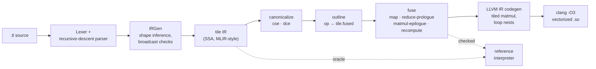

# tilec: a tile-based ML kernel compiler (C++17 → LLVM IR)

`tilec` compiles a small Triton-style DSL for ML kernels (matmul, softmax,
LayerNorm, attention, GELU) through an SSA tile IR, an optimization and
kernel-fusion pipeline, and a lowering to LLVM IR with cache-blocked matmul
code generation. It ships with FileCheck-style IR tests, end-to-end numerical
tests against NumPy, a differential fuzzer, sanitizer builds, CI, and a
performance study.

```python
# examples/mlp.tl
@tile(32, 128, 128)
kernel mlp(x: f32[256, 512], w: f32[512, 128], b: f32[128]) -> f32[256, 128] {
  return relu(x @ w + b)        # one tiled matmul, bias + ReLU fused into its epilogue
}
```

```
$ tilec examples/mlp.tl --emit=ir-opt
tile.func @mlp(%0: tensor<256x512xf32>, %1: tensor<512x128xf32>, %2: tensor<1x128xf32>) -> tensor<256x128xf32> attributes {tile = [32, 128, 128]} {
  %3 = tile.fused(%0, %1, %2) {matmul} iter [256x128] : tensor<256x128xf32> {
    ^0 = acc
    ^1 = in 2
    ^2 = add ^0, ^1
    ^3 = relu ^2
    yield ^3
  }
  tile.return %3 : tensor<256x128xf32>
}
```

## Pipeline



| Stage | File | What it does |
|---|---|---|
| Frontend | `src/Lexer.cpp`, `src/Parser.cpp` | Tokens with source locations; grammar in `include/tilec/Parser.h`; clang-style diagnostics with caret |
| IR generation | `src/IRGen.cpp` | Name resolution, rank-2 canonicalization, NumPy broadcasting, matmul/reduction shape inference |
| IR | `src/IR.cpp` | SSA ops, MLIR-flavoured printer, structural **verifier** (dominance, shapes, body well-formedness) |
| Optimizer | `src/Passes.cpp` | Constant folding, algebraic identities (shape-aware), CSE, DCE, pass manager with `--print-ir-after-all`, `--verify-each`, `--time-passes` |
| Fusion | `src/Fusion.cpp` | Producer/consumer fusion with explicit legality rules and a static cost model |
| Codegen | `src/LLVMCodegen.cpp` | One loop nest per fused kernel; i0/j0/k0 cache-blocked matmul with i-k-j micro-kernel and in-cache epilogue; `noalias` ABI so LLVM vectorizes |
| Interpreter | `src/Interpreter.cpp` | Executes IR at any pipeline stage, the oracle for differential testing |
| Runtime | `python/tilec/runtime.py` | `.tl → .ll → .so`, called on NumPy arrays via ctypes |

Design details and trade-offs: [docs/DESIGN.md](docs/DESIGN.md).

## Quick start

Requires a C++17 compiler, CMake ≥ 3.16, LLVM/clang (tested with 18), Python 3 with NumPy and pytest. Linux, developed on Ubuntu 24.04.

```bash
cmake -S . -B build -G Ninja -DCMAKE_BUILD_TYPE=Release
ninja -C build
ctest --test-dir build --output-on-failure      # lit + e2e + fuzz

./build/tilec examples/softmax.tl --emit=ir-opt --stats
./build/tilec examples/mlp.tl -o mlp.ll && opt -passes=verify -disable-output mlp.ll
python3 bench/bench.py
```

```python
import sys, numpy as np; sys.path.insert(0, "python")
import tilec
attn = tilec.compile_file("examples/attention.tl")["attention"]
q, k, v = (np.random.randn(128, 64).astype(np.float32) for _ in range(3))
out = attn(q, k, v)            # native, vectorized code generated by tilec
```

## The DSL

```
kernel name(arg: f32[M, N], vec: f32[N], scalar: f32) -> f32[M, N] { stmts }
@tile(TM, TN, TK)                      # optional per-kernel matmul tile sizes
x @ w   matmul(a, b)   transpose(x)    + - * /   -x   max(a, b)   min(a, b)
exp log sqrt tanh relu                 sum(x, axis=0|1)   max(x, axis=0|1)
```

Shapes are static, broadcasting follows NumPy (size-1 dimensions), reductions keep the reduced dimension.

## Fusion rules

All rules run on outlined `tile.fused` kernels and require the producer's shape to equal the consumer's iteration space, so no work is silently duplicated:

1. **Map fusion**: a single-use elementwise producer is inlined into its consumer (elementwise chains, reduction prologues like `sum(x * x)`, and extra epilogue inputs such as a residual).
2. **Matmul epilogue fusion**: a single-use matmul feeding a pure map becomes one tiled kernel whose epilogue runs while each C tile is still in cache.
3. **Recompute fusion**: a multi-use map whose body cost is ≤ `--recompute-budget` is duplicated into every consumer, so the intermediate tensor is never written to memory. The default budget (4) was chosen from measurements, see below.

Producers of a matmul's A/B operands are never fused into the matmul, a reduction result is never broadcast-fused (that would recompute the reduction per element), and a matmul is never recomputed.

## Results

Single thread, Intel Xeon @ 2.3 GHz (AVX-512), clang 18 `-O3 -march=native`. Full tables and methodology: [bench/results/RESULTS.md](bench/results/RESULTS.md).

**Matmul 512³**

| implementation | GFLOP/s | vs naive |
|---|---:|---:|
| naive i-j-k (`--no-tile`) | 2.5 | 1.0x |
| tilec tiled 32×256×128 | 38.8 | **15.7x** |
| OpenBLAS (hand-written asm, packing, register blocking) | 148.9 | 60.3x |

A tile-size sweep shows a broad plateau (≈37–39 GFLOP/s) while the C tile plus B panel fits in L2, and a cliff to ≈21 GFLOP/s once the working set reaches ~640 KiB.

**Fusion** (loop nests and intermediate bytes from the optimized IR)

| kernel | loop nests | intermediates | speedup |
|---|---:|---:|---:|
| LayerNorm 256×768 | 11 → 5 | 3078 KiB → 4 KiB | **1.81x** |
| GELU 512×512 | 9 → 1 | 8 MiB → 0 | 1.06x |
| MLP 256×512×128 | 3 → 1 | 256 KiB → 0 | 0.98x |
| softmax 128×1024 | 5 → 4 | 1025 KiB → 513 KiB | 1.00x |
| attention 128×64 | 9 → 7 | 353 KiB → 225 KiB | 1.03x |

What the numbers say:

- **Recompute fusion has to be cost-modelled.** With the budget at 16, the optimizer duplicated `exp(x - m)` into both of softmax's consumers. That removed a 512 KiB intermediate but made softmax 1.3x *slower* and attention 1.2x slower, because `exp` costs far more than an L2 round-trip. Lowering the budget to 4 keeps cheap recomputation (LayerNorm's centering) and rejects transcendentals.
- **GELU is compute-bound on scalar `tanhf`.** LLVM 18's libmvec mapping covers `exp`/`log` but not `tanh`, so removing 8 MiB of traffic only buys 6%. A polynomial `tanh` lowering is the obvious next step.
- **MLP is matmul-bound.** The epilogue is about 0.2% of the FLOPs, and the gap to OpenBLAS is packing plus register blocking, not fusion.
- **Vector libm matters.** Compiling with `-fveclib=libmvec` cut softmax from ~590 µs to ~400 µs.

## Testing

| Suite | What it checks |
|---|---|
| `tests/lit/` (23 files) | FileCheck-style tests on the printed IR and LLVM IR for every pass (folding, CSE/DCE, each fusion rule and its negative cases), codegen flags, generated IR validity via `opt -passes=verify`, and 14 diagnostic tests (`not tilec ... \| filecheck`). Runner and FileCheck clone in `tools/`. |
| `tests/e2e/` (55 tests) | Every example compiled under 6 pipeline configurations (fusion on/off, `-O0`, naive vs tiled, odd tile sizes that exercise remainder loops) and compared to NumPy; interpreter stages vs native code; edge-case matmul shapes (1×1×1, 5×300×3, 130×70×257). |
| `tests/fuzz/` | Differential fuzzer that generates random well-typed programs (matmul in ~80%, reductions, transposes, broadcasting, reused values) and checks frontend IR ≡ optimized IR ≡ native code under a random pipeline config with `--verify-each`. 2,000 programs pass. It was validated by planting two real bugs (a broadcast-indexing error in codegen and a missing fusion legality check), which it caught in 16/60 and 5/60 programs. |
| Sanitizers | `-DTILEC_SANITIZE=ON` builds with ASan + UBSan; all three suites pass clean. |
| CI | `.github/workflows/ci.yml`: clang Release and gcc ASan/UBSan matrix, plus a clang-format check; fuzz repros are uploaded as artifacts on failure. |

## Limitations and roadmap

- The tile IR is MLIR-*style* (SSA, regions-as-bodies, verifier, printer), not an MLIR dialect. **Next:** define `tile` in ODS/TableGen and lower through `linalg`/`scf` to the LLVM dialect.
- CPU only. **Next:** a GPU backend: emit SYCL or Triton for the same fused kernels, mapping tiles to work-groups.
- Matmul stops at cache blocking. **Next:** pack B panels and add a register-blocked micro-kernel, then parallelize the i0/j0 loops with OpenMP.
- Static shapes, f32, rank ≤ 2. **Next:** symbolic dimensions and bf16/f16.
- **Next:** expose kernels as a PyTorch custom op through `torch.library` and check them against `torch.nn.functional`.

## Layout

```
include/tilec/   public headers (AST, IR, passes, codegen, interpreter)
src/             compiler implementation (~2.5k lines C++)
tools/tilec/     driver           tools/*.py   lit runner, FileCheck clone, `not`
python/tilec/    ctypes runtime   examples/    mlp, softmax, gelu, layernorm, attention
tests/           lit/  e2e/  fuzz/            bench/  performance study + results
docs/DESIGN.md   design notes
```
